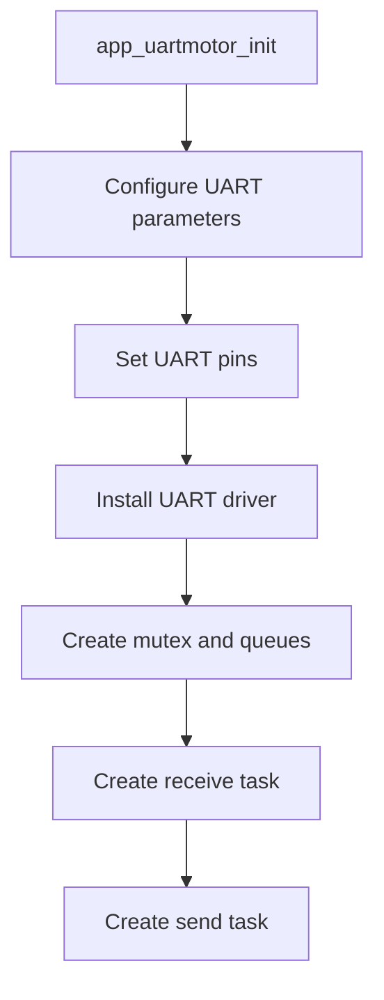
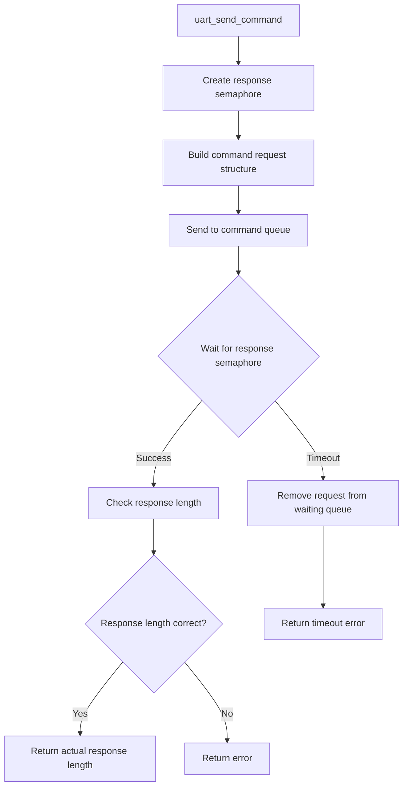
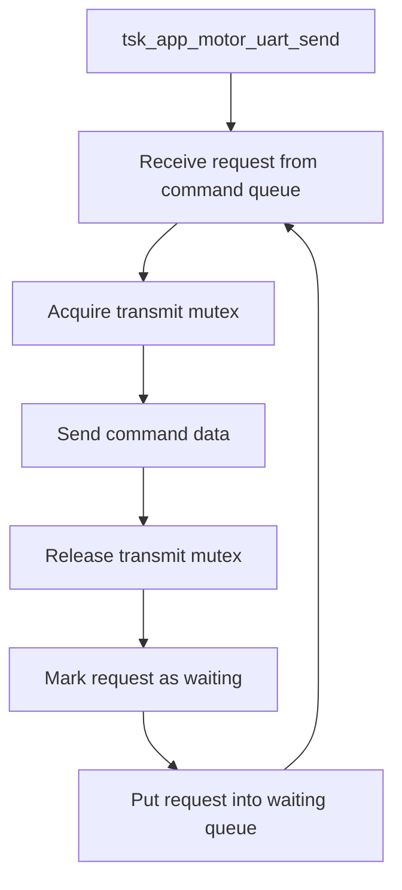
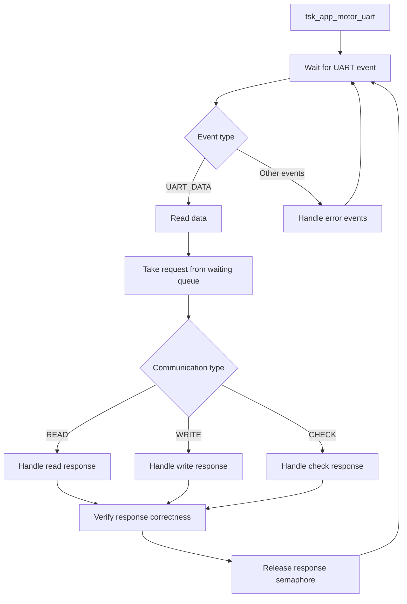
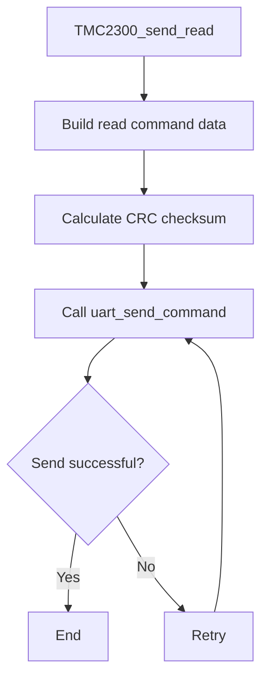
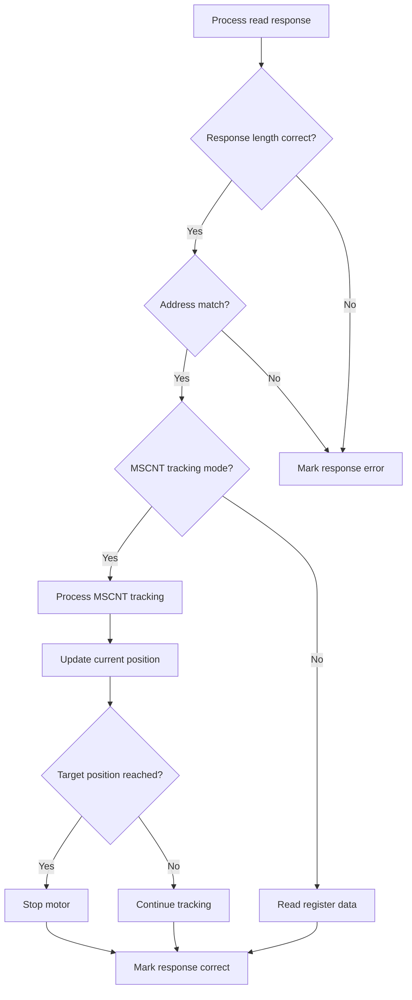
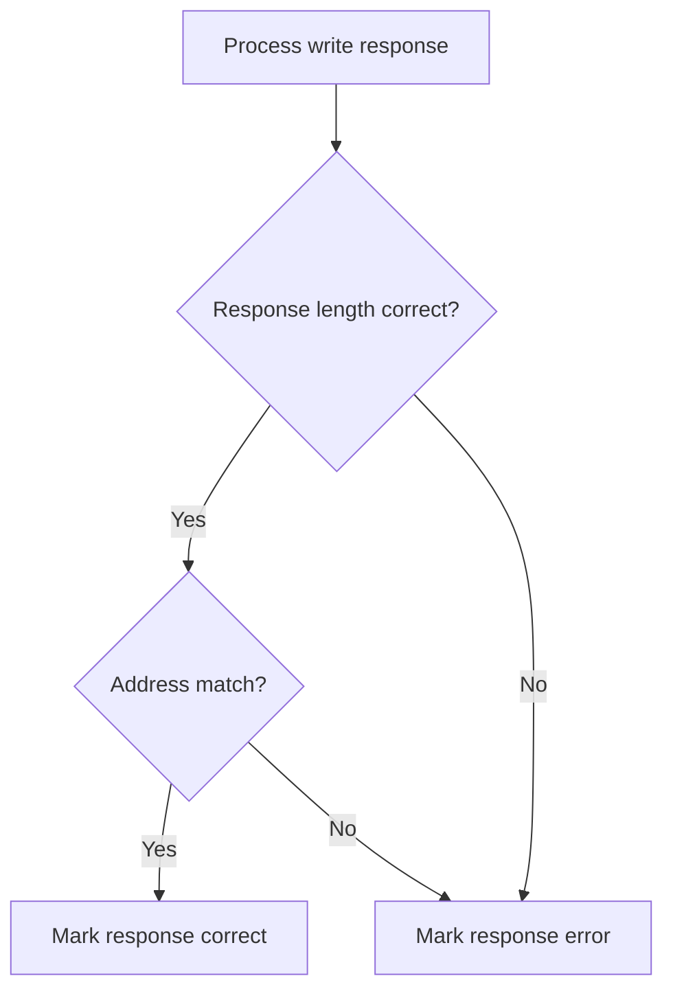
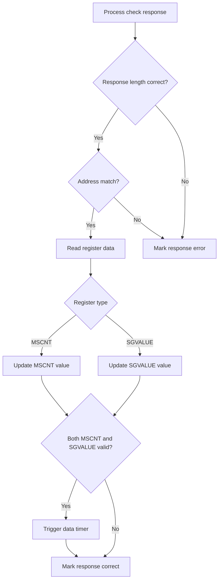

# Full-Stack Solution for Precision Control and Testing of Miniature Stepper Motors Based on ESP32-S3 and TMC2300

## Solution Selection Rationale

From a cost perspective, the TMC2300 is relatively expensive and is not suitable for low-price competition in red-ocean markets.  

However, for projects that are **cost-insensitive but extremely sensitive to space, volume, control algorithms, and development time (e.g., handheld terminals, miniature 3D printers, medical instruments, and other miniaturized high-value electronic devices)**, and that need to achieve capabilities such as low-voltage power supply (battery-compatible), silent operation (close to users), energy saving (extended battery life), and precise positioning (guaranteed functionality), the TMC2300 is a very mature choice.  
In particular, **the adaptive algorithms it provides make it one of the choices that can quickly enable product development in scenarios without extensive experience in motor operation configuration and tuning data.**

When developing a medical device testing project, the author comprehensively considered development time cost and precise control objectives, and ultimately made this hardware selection.

### Core Selection Philosophy
Use ESP32-S3 as a flexible main control hub, TMC2300 as a low-voltage, silent, highly integrated driver core, pair it with a suitable miniature stepper motor and power system, and leverage the mature ESP software ecosystem to complete a full-stack hardware and software design from low-level drivers to upper-level test software.

---

## TMC2300 Feature Overview

> 💡 For detailed TMC2300 parameters, please refer to the chip manufacturer's official documentation: [Analog Devices - TMC2300](https://www.analog.com/en/products/tmc2300.html)

### Electrical Specifications and Compatibility
* **Operating voltage range**: 2V to 11V DC.
* **Power supply compatibility**: Supports 1 to 2 lithium-ion cells, or at least 2 AA/NiMH batteries.
* **Current drive capability**: Output current capability is 1.2 A RMS (2 A peak), sufficient to drive miniature stepper motors such as NEMA8, NEMA11, and small NEMA14.
* **Ultra-low power consumption**: Its typical standby current is below 50 nA, which is critical for battery-powered portable test equipment.

### Core Technical Features
* **StealthChop2™ chopper**: Achieves nearly silent motor operation, and in test scenarios can completely eliminate driver noise interference with measurement signals.
* **CoolStep™ load-adaptive energy saving**：Dynamically adjusts current according to load, saving up to 90% energy, while significantly reducing system heat.
* **StallGuard4™ sensorless stall detection**：Can sensitively detect motor step loss in StealthChop mode, providing a sensorless encoder-free means of step-loss monitoring for test solutions.
* **MicroPlyer™ interpolation**：Even if the external input pulse resolution is low, it can achieve smooth operation with 256 microsteps through internal interpolation.

### Design Notes on Selected Key Features
#### VCP Internal/External Selection
Charge pump voltage is a dedicated "higher-than-supply-voltage" drive voltage generated internally by the motor driver chip to fully turn on the high-side MOSFETs. Since the TMC2300 is a low-voltage chip (rated 2 V–11 V), its charge pump usage is critical.
The following is a detailed comparison of the two settings:

1. **External VCP setting (Standard Mode)**  
This is the most common standard circuit. Connect a 100 nF capacitor between the VCP pin and VS (power supply).  
**Advantages:**  
• Highest efficiency: The charge pump draws energy directly from the power supply (VS), providing the strongest gate drive capability and thereby reducing MOSFET on-resistance.  
• Good stability: The external capacitor can be selected as a higher-quality component as needed, reducing voltage ripple.  
**Disadvantages:**
• Component footprint: Requires an additional capacitor's PCB space.  
• Low-voltage limit: When battery voltage drops extremely low (e.g., approaching 1.8 V), if VS voltage fluctuates too much, the charge pump may not be able to maintain sufficient drive voltage difference.  

2. **Internal VCP setting (Internal Mode)**  
In some design references, this usually refers to connecting the VCP capacitor to the chip's internal 5 V regulator output (VCC_IO) or a similar stable reference source, or using fully integrated logic if a specific version supports it. For the TMC2300, one of the most common variants is to use the internal LDO to provide initial charge.  
**Advantages:**  
• Ultra-low-voltage operation: Because the charge pump's "base" voltage is provided by a stable internal LDO, even if the external battery voltage (VS) fluctuates, the charge pump can still generate a stable drive voltage. This is very suitable for extreme cases when a single lithium cell or two AA batteries are nearly depleted.  
• Space saving: In a very small number of highly integrated solutions, the number of external components can be reduced.  
**Disadvantages:**  
• Power limitation: The internal regulator's current output is limited, so at high speed or high current load, the charge pump replenishment speed may not be as fast as when connected directly to VS.  
• Heat: Because energy passes through the internal LDO conversion, it slightly increases the chip's quiescent power consumption and heat.   

#### Understanding and Application of TSTEP 
The TSTEP register value is a direct reading indicating the time taken to complete the previous microstep. It is inversely proportional to the step frequency (f_STEP) and motor speed. Its calculation formula is: TSTEP = f_CLK / f_STEP  
f_CLK: The chip's system clock frequency (in Hz), for example 12 MHz.  
f_STEP: The current microstep frequency (in Hz).   

**Main Uses**  
A. Set the switching threshold between StealthChop and SpreadCycle.
This is the most core use of TSTEP.  
Write a set threshold to the TPWMTHRS register, and the chip will automatically compare the current TSTEP with TPWMTHRS.  
• When TSTEP > TPWMTHRS (i.e., at lower speed), the chip uses ultra-quiet StealthChop mode.  
• When speed increases such that TSTEP < TPWMTHRS, the chip automatically switches modes.  

B. Assist position tracking (compensating for control delay or motor step loss)  
For example, in the author's MSCNT tracking solution using ESP, TSTEP can provide an important auxiliary reference:  
Because reading MSCNT over UART has latency, you can read TSTEP to know the motor's true linear speed at that instant.  
If timer polling becomes slow, the TSTEP value can be used to predict whether MSCNT is about to roll over, thereby providing advance warning in the algorithm.  
**Key**: Since TSTEP is read through the serial port, baud rate and rotational speed are critical. If the speed is very fast and the baud rate cannot keep up with the state changes caused by speed, the interval information read becomes meaningless.  

#### Cautious Use of SG_VALUE
The SG_VALUE value represents the motor's current load margin.
Value range: 0–511 (9-bit unsigned).  
• Larger value: The motor runs more easily, the load is small, and surplus torque is sufficient.  
• Smaller value: The motor load is heavier, and resistance is greater.  
• When approaching 0: The motor has almost no surplus torque and is about to stall.  
Measurement principle: It estimates load by measuring the energy feedback from the motor coil's back-EMF (Back-EMF).  
The advantage of this measurement is that it requires no external encoder or current sensor. However, we must strictly understand the calculation principle of SG_VALUE.  
It is based on a key characteristic of StallGuard2 technology: that is, the SG_VALUE reading is proportional to "energy efficiency," not directly to "mechanical load." Speed affects the amplitude of back-EMF, and back-EMF is the physical basis by which StallGuard2 measures load.  
  
StallGuard2 technology detects load by measuring the difference between electrical energy flowing into the motor and flowing out of the motor. The lower the mechanical load, the greater this energy difference, and the higher the SG_RESULT reading; the higher the mechanical load, the smaller the energy difference. When the SG_RESULT reading approaches 0, it means energy is completely converted into mechanical work, the load is at maximum, and the motor is close to stalling.  
This means that SG_VALUE essentially reflects the motor's "energy efficiency" rather than directly measuring "mechanical resistance." When speed increases but mechanical load remains unchanged, this "energy difference" may be artificially amplified. 
   
Therefore, in practical applications, we should use SG_VALUE cautiously for load judgment.  
• Calibrate the SGTHRS threshold at typical operating speed.
SG value is highly correlated with speed, so its calibration process must be performed at the preset actual operating speed. If the motor is used at only one fixed speed, calibrating at that speed is sufficient.  
• If speed varies widely, SGTHRS threshold can be adjusted in real time.
If the application requires accurate StallGuard2 measurement over a wide speed range, a more advanced approach can be adopted: adjust the SGTHRS threshold in real time according to speed. A simple implementation method is to optimize the SGTHRS value separately at two different speeds, then perform linear interpolation between these two speed values. This can obtain most of the benefits of dynamic adjustment.  
• Never calibrate at no-load or extremely low speed.  
StallGuard2 measurement requires appreciable back-EMF; therefore, its calibration must be performed within the effective speed range, not when the motor is completely unloaded or at extremely low speed.  

#### TCOOLTHRS and SGTHRS Feature Description 
**TCOOLTHRS (Speed Threshold Switch)**  
TCOOLTHRS is essentially a time constant threshold. It corresponds to the TSTEP value.  
Since TSTEP is inversely proportional to speed (the faster the speed, the smaller the TSTEP):  
When TSTEP < TCOOLTHRS (i.e., the motor is rotating fast enough), StallGuard and CoolStep functions are enabled.  
When TSTEP > TCOOLTHRS (i.e., the motor is rotating too slowly), because back-EMF is too weak, load detection is unreliable, and the related functions are automatically disabled.  

**Practical uses**
1. Shield low-speed interference: Prevent the motor from generating false stall signals during startup, stop, or extremely low-speed crawling due to insufficient back-EMF.  
2. Power optimization: Only when this speed is reached will the chip consume resources to calculate the load angle.  

**SGTHRS (Stall Detection Sensitivity Threshold)**  
Physical meaning: SGTHRS is the zero-point calibrator of StallGuard4. It directly determines at what load SG_VALUE will return to zero.  
It is not a physical unit, but a comparison reference.
Adjustment logic:  
• Increasing SGTHRS: Makes SG_VALUE drop toward 0 more quickly (more sensitive; a light touch triggers an error).  
• Decreasing SGTHRS: Keeps SG_VALUE at a higher level (less sensitive; requires much greater force to trigger an error).  

**Practical uses**  
1. Adapt to different motors: Each motor has different internal resistance and back-EMF constant. SGTHRS compensates for these differences so that different motors can output 0 at stall.  
2. Environmental adaptation: If mechanical structure wear causes increased inherent resistance, SGTHRS can be lowered to prevent false alarms.   

**Cooperative Relationship Between the Two (Workflow)**  
Suppose you want to implement automatic shutdown when an obstacle is encountered during a 90° rotation:  

1. Startup phase: The motor accelerates from 0. At this time TSTEP > TCOOLTHRS, SG_VALUE is invalid, and the system ignores it.  

2. Running phase: Speed reaches the threshold, TSTEP < TCOOLTHRS. The chip begins updating SG_VALUE.  

3. Load detection:  
If the motor rotates normally, SG_VALUE remains between 100–200 (depending on your SGTHRS tuning).  
If it hits a hard limit, load increases sharply, and SG_VALUE rapidly drops to 0.  

4. Trigger stop: The MCU detects SG_VALUE returning to zero and immediately sets VACTUAL=0.   


---

## Hardware Design  
[Schematic file](./Hardware/SCH_MotorControl.pdf)  
[Layout file](./Hardware/PCB_MotorControl.pdf)  

### 1. Power Supply Design (Motor Power)
* **Design core**: Uses the LMR14030 switching power supply solution, which is cost-effective, supports wide voltage input, and effectively controls cost. It supports external power or low-voltage battery power through jumpers. A simple LC second-stage filter can achieve ripple < 10 mV. The switching frequency can be programmed between 200 kHz and 2.5 MHz. This example uses 500 kHz, which ensures voltage regulation accuracy under large voltage differences while also balancing efficiency at maximum 2 A output.


#### Undervoltage Protection Circuit (J101)
* Voltage is divided through R100 (280 kΩ) and R101 (31.6 kΩ) into the EN pin of U100.  
* Default shorted: When the jumper is shorted, it is enabled, with startup voltage set to 11.5 V and shutdown voltage set to 10.5 V.    
  * Function: Ensures the motor starts only when input voltage is sufficiently stable, preventing over-discharge during battery operation.

* Open (low-voltage mode): If used in a power supply environment below 11.5 V, the J101 jumper can be disconnected to disable UVLO. The chip can then operate normally down to 4 V, suitable for single/dual-cell battery power modes.

#### Adjustable Motor Supply Output (J102)  
* Equipped with a voltage adjustment jumper and adjustable resistor R106 (50 kΩ).
* Adjustment function: Supports fixed or adjustable output modes. By precisely adjusting the adjustable resistor, VCC_IN can be stabilized at the optimal operating voltage required by the TMC2300 motor driver (the TMC2300 common voltage range is generally 1.8 V–11 V).

#### Second-Stage Filtering (LC Ripple Suppression)
1. The main inductor L100 (22 µH) and C103/C104 (47 µF) form the first-stage Buck filter.

2. Then, through a ferrite bead/small inductor L101 (1 µH) and C105–C108, an LC π-type filter is formed to deeply filter switching high-frequency noise and provide clean power for the motor and sensitive driver section. 

#### Further Potential Optimizations
Limited by space and cost, the current design retains some potential optimization possibilities that may be considered in future versions.  

1. Reserve pad locations for large-capacity electrolytic capacitors (e.g., 100 µF–470 µF) at the VCC_IN power input interface. Stepper motors generate huge transient current demands during chopper driving and frequent acceleration/deceleration. Large-capacity energy storage capacitors can effectively smooth bus voltage drops and maintain stable power-stage supply.

2. Add reverse-polarity protection at the power input. Use a P-MOSFET reverse-polarity protection circuit or a series Schottky diode to prevent irreversible damage to downstream driver chips and the MCU caused by reversed test bench power polarity.

3. To ensure a clean reference for power measurement, configure a complete filtering network at the power input: large-capacity electrolytic capacitors for low-frequency energy storage, high-frequency ceramic decoupling capacitors (100 nF/10 µF) to absorb high-frequency ripple generated by PWM chopping, and a series common-mode inductor to suppress common-mode interference, preventing motor drive noise from coupling into the measurement and control loop.

4. Avoid the current surge at motor power-on causing sudden electromagnetic force changes, which can cause mechanical shock and vibration. It is recommended to introduce an RC soft-start circuit at the power control end, extending the current rise edge to tens of milliseconds, which can reduce the power-on surge current by more than 60%. Add an RC delay at the TMC2300 enable pin (EN), with a reverse diode in parallel across the resistor for fast discharge at power-off.

5. For back-EMF caused by sudden external reverse rotation or emergency stop of the motor (which may break down driver transistors), build multi-layer protection:
Freewheeling and absorption: Configure fast-recovery freewheeling diodes at the drive outputs (to the motor windings) to provide a discharge path; and connect an RC snubber network (e.g., 100 Ω + 10 nF) across the windings to reduce high-frequency voltage spikes.
Overvoltage clamping: Connect TVS transient voltage suppression diodes or metal oxide varistors (MOVs) in parallel at the drive power input and output. When back-EMF causes bus voltage to surge, TVS/MOV can respond at the ns level, clamping voltage within the safe operating area and protecting downstream chips.

6. Deploy NTC temperature sensors near the TMC2300 driver chip and sampling resistors to monitor thermal runaway risk in real time, and set thresholds to implement hardware-level overtemperature shutdown or software derating, ensuring long-term reliability and consistency of measurement parameters.

### 2. TMC2300 Driver Circuit Design

#### Core Control Interface and Configuration
The chip's control pins are directly connected to the main controller (ESP32-S3), supporting single-wire UART configuration or traditional pulse/direction control:

* **Control signals**: LM_DIR (direction), LM_STEP (pulse step), and LM_EN (enable) form the basic motor control interface.

* **Communication interface**: Chip pin 10 (PAN_UART) is connected to LM_UART_TX through R507 (1 kΩ), and pulled down through R508 (100 kΩ), supporting the main controller in configuring the chip's internal registers (such as current, microstep, StealthChop mode parameters, etc.) via single-wire UART.

* **Address and mode configuration**: MS1_AD0 and MS2_AD1 are used to set the UART communication hardware address. R506 (10 kΩ) pulls LM_MODE up to IO3.3V, causing the chip to operate in the intended mode.

* **Diagnostic output**: LM_DIAG (pin 12 DIAG) outputs fault diagnostic signals, which can be used for overtemperature, overcurrent, and other fault detection back to the main controller.

#### Standby and Power Control
The circuit designs a power switch circuit composed of PMOS (Q300) and NMOS (Q301):

* **Logic mechanism**: When the main controller pulls the standby control signal LM_STDBY high, Q301 turns on, thereby pulling the gate of Q300 low to turn it on, delivering the IO3.3V supply to the right-side !O3.3V node.

* **Chip power supply**: IO3.3V supplies power to pin 11 VIO/NSTDBY of the TMC2300.

* **Energy-saving design**: When the system is in sleep or long-term standby, the main controller can turn off LM_STDBY, completely cutting off VIO power and placing the chip in an extremely low-power standby mode, while the LED300 indicator also turns off.

#### Motor Operating Current Jumper Selection Circuit
This design does not use a fixed sampling resistor. Instead, it uses jumper combinations (J500–J505) to flexibly change the feedback current (sampling resistor values at the BRA and BRB pins):  

* **Resistor network configuration**:

    * First group (J500/J503): R500 (150 mΩ)/R503 (150 mΩ)

    * Second group (J501/J504): R501 (330 mΩ)/R504 (330 mΩ)

    * Third group (J502/J505): R502 (1 Ω)/R505 (1 Ω)

* **Design function**: By manually inserting/removing jumper caps or soldering to select different jumper combinations, the equivalent parallel resistance of BRA and BRB relative to ground (GND) can be changed. According to the formula:
  \[\text{I}_{\text{rms}} \propto \frac{1}{\text{R}_{\text{sense}}}\]  
This achieves the purpose of quickly manually adjusting and selecting multiple different motor operating currents without resoldering, greatly improving the hardware board's versatility.

#### Output Filtering and EMC Optimization
Between the chip outputs (OA1, OA2, OB1, OB2) and the motor interface (J400), fine filtering and electromagnetic compatibility (EMC) protection are designed:

* **Ferrite bead isolation**: High-frequency ferrite beads L500–L503 (such as MMZ1608, MMZ1808, etc.) are connected in series at the outputs, specifically to suppress high-frequency H-bridge switching noise and prevent it from radiating outward.

* **Filter capacitor network**: Capacitors C400–C403 (470 pF) and resistors R400–R403 (usually very small resistance, presenting a specific impedance at 1 MHz) are connected in parallel on the motor output lines. They form a low-pass filter, absorbing back-EMF high-voltage pulses and spikes generated by the stepper motor coils, protecting the chip's internal MOSFETs from breakdown while reducing electromagnetic radiation.

---

## PCB Layout Optimization Notes

### 1. TMC2300 Thermal Design
The TMC2300 package is very compact, and the current for driving the motor and the actual operating power may be relatively large, causing significant local temperature rise. Therefore, thermal design and power/ground loop (Power Integrity) PCB layout design are crucial.

The TMC2300 has an exposed thermal pad (Exposed Die Pad, EP) at the bottom center, which is the chip's main heat dissipation path. During design, note:

* **Multilayer board and complete ground plane**: If conditions permit, a 4-layer board design is recommended. Use the second layer (Layer 2) as a complete GND plane to provide huge thermal capacity.

* **Thermal via design**: On the EP pad at the bottom of the chip, 4 to 6 thermal vias (approximately 0.3 mm diameter) must be placed. Do not cover the vias with solder mask; connect them directly to the bottom layer and inner-layer GND, conducting heat to a large copper area.

* **Backside opening**: On the PCB bottom layer, apply large-area copper pour at the position corresponding to the chip pad and remove the solder mask (open window and tin-plate), increasing air convection cooling. If necessary, attach a small heat sink.

> ⚠️ **Thermal testing specification**: During actual testing, the system should be continuously run under the design's maximum power and maximum motor operating duration. Use an infrared thermal imaging camera to capture the operating temperature map from the power supply to the TMC2300, and analyze the actual temperature rise of each unit in detail for further design adjustments and improvements.

### 2. Power Layout and Filtering
When using a switching power supply chip for large-current switching (H-bridge switching), severe voltage pulses and ripple are generated on the power line. Therefore, the following design principles should be noted:

* **Proximity principle**: Large capacitors and decoupling capacitors must be close to the chip's VS and GND pins.

* **Large before small**: Before the power line enters the chip, it should first pass through large-capacity capacitors, then small-capacity capacitors, and finally enter the chip pins.

* **Capacitor ground return**: The ground terminals (GND) of these capacitors should be connected directly to a large-area ground plane through multiple large-aperture vias, ensuring that high-frequency H-bridge currents can return quickly and locally.

### 3. Ground Plane Isolation and Single-Point Grounding
* **Power ground and signal ground partitioning**: Divide the board ground into motor power ground (PGND) and system signal ground (AGND/GND).

    * *PGND area*: Includes the TMC2300 chip bottom EP, power input capacitor ground terminals, and sampling resistor ground terminals. This area should have independent large-area copper pour.

    * *AGND area*: Includes ESP32-S3, communication interfaces, and the TMC2300 VIO capacitor ground terminal.

* **Single-point connection**: The two ground planes are hard-connected at only one point on the entire board (usually at the negative terminal of the main power input, or through a 0 Ω resistor/ferrite bead), avoiding large current return flowing into the main controller's ground network and causing ESP32 resets or UART communication packet loss.

### 4. Motor Supply Power Line Design and EMC Optimization
The 4 lines from the chip outputs to the motor interface carry all the large current for driving the motor. The design principles are:

* **Trace width and copper thickness**: At 1 oz copper thickness, a trace width of no less than 0.8 mm–1.2 mm is recommended (the wider the better if space permits). If conditions permit, using 2 oz copper thickness can significantly reduce heat.

* **Ferrite bead and capacitor placement**: Filtering ferrite beads and filter capacitors should be placed close to the chip output pins, absorbing high-frequency spikes first, and then routed with thickened traces to the motor connector.

* **Keep away from sensitive signals**: These 4 output lines are full of high-frequency, high-voltage PWM signals. They must not be routed in parallel over long distances with low-voltage signal lines such as the main controller's UART, STEP/DIR, etc., to prevent electromagnetic crosstalk.

---

## Firmware Design

Firmware development is based on the ESP-IDF FreeRTOS system and uses C language for core code development.  

### 1. Code Architecture Design
The code architecture adopts a self-built task-system-based simple finite state machine (FSM).

#### Main State Architecture
[Main State Architecture](./Images/fsm_main.png)  

#### Substates (Motor Running State Architecture)
[Substate example](./Images/fsm_run.png)  

#### Main Program Core Operation Logic
1. After completing initialization of firmware and related hardware, the main program initializes the state machine and enters the state machine initialization complete state.

2. The state machine fully takes over system operation and, according to different operation instructions, switches between different states to ensure operation commands are fully executed.

3. For abnormal situations, it switches to the error state (MODE_ERROR) for exception handling and immediate feedback.

> 📝 *Note: For actual code implementation, please refer to the state machine core source code section in the project.*

### 2. TMC2300 Serial Communication Code Architecture
In practical applications, there may be a large number of interactions between motor operation control commands and status query commands. Therefore, serial data transmission and reception use RTOS synchronization mechanisms such as queues and mutexes to ensure complete transmission/reception and sequential execution of related control/query commands, effectively avoiding resource conflicts and blocking occupation.

#### Serial Task Allocation
An independent dual-task processing mechanism is adopted:
* Independent serial send task: `static TaskHandle_t motor_uart_send_task_handle = NULL`
* Independent serial receive task: `static TaskHandle_t motor_uart_rec_task_handle = NULL`

#### Queue and Mutex Configuration

| Name | Type | Purpose |
| :--- | :--- | :--- |
| `s_motor_uart_rec_queue` | `QueueHandle_t` | UART receive event queue |
| `uart_cmd_queue` | `QueueHandle_t` | Command transmit queue |
| `uart_tx_mutex` | `SemaphoreHandle_t` | UART transmit mutex |

#### Related Core Data Structures

```c
typedef struct
{
    uint8_t cmd[CMD_MAX_LEN];
    int cmd_len;
    // uart_send_fail_callback_t fail_callback;  // 发送失败回调函数指针，暂时不用
    int resp_len;
    uint8_t reg_addr;
    motor_uart_communicate_type_t type;
    bool is_pending;
} uart_cmd_t;

typedef struct 
{
    // 命令信息
    uint8_t cmd_buf[CMD_MAX_LEN];
    int cmd_len;
    
    // 响应信息
    uint8_t *resp_buf;               // 存放响应的缓冲区
    int resp_max_len;
    int resp_len;                    // 实际接收到的响应长度
    
    // 针对TMC2300通信的特定字段
    motor_uart_communicate_type_t type;
    uint8_t reg_addr;
    uint32_t reg_data_read;
    bool is_correct;
    
    // 同步机制：从信号量修改为任务通知（Task Notification），减少系统开销
    TaskHandle_t task_handle;        // 发送任务的句柄
    uint32_t id;                     // 请求ID，由随机数生成，用于匹配响应和请求
    TickType_t timeout_ticks;
    
    // 标志位：标记此请求是否仍在等待响应
    volatile uint8_t is_pending;
} uart_cmd_request_t;

static uint8_t uc_motor_reg = 0;

/**
 * @brief 电机状态检查日志结构体
 * @details 用于记录电机状态检查的结果，包括当前时间、当前循环次数、电机状态、MSCNT值、SG值等。
 */
typedef struct 
{
    uint32_t time_tick;
    uint32_t cur_cycle_count;
    char motor_status;
    
    // MSCNT计数依赖串口，此方案已切换为使用更精准的脉冲计数
    uint16_t mscnt;
    bool mscnt_valid;
    uint32_t pluse_count;
    bool pluse_count_valid;
    
    // 扭矩余量
    uint16_t sgvalue;
    bool sgvalue_valid;
} motor_check_log_t;

static volatile motor_check_log_t motor_check_log;

/**
 * @brief 电机MSCNT检查结构体
 * @details 用于记录电机MSCNT值的检查结果，包括目标值、当前值、前一个值、是否启用慢进、是否运行慢进、慢进速度、是否停止等。
 */
typedef struct 
{
    bool valid;
    bool direction;
    uint32_t mscnt_target;
    uint32_t mscnt_current;
    uint32_t mscnt_previous;
    bool slowapproach_enable;
    bool slowapproach_run;
    int32_t slowapproach_speed;
    bool stop;
} motor_mscnt_check_t;

static volatile motor_mscnt_check_t motor_mscnt_check = { false, true, 0, 0, 0, false, false, 0, false };

typedef struct 
{
    uint32_t target_pulse;    
    bool close_target;
} motor_pluse_check_t;

static volatile motor_pluse_check_t motor_pluse_check = { 0, false };

// 非阻塞底层字节发送函数接口
esp_err_t app_exuart_bytes_noneblock(
    char *tx_message,
    size_t tx_message_size,
    TickType_t tx_none_block_timeout);
```

#### Serial Transmit/Receive Functional Flow
##### 1. Initialization Flow



##### 2. Send Command Flow



##### 3. Send Task Flow



##### 4. Receive Task Flow



##### 5. TTMC2300 Communication Flow

###### 5.1 Write Operation


###### Read Operation



##### 6. Data Processing Flow

###### 6.1 Read Response Processing



###### 6.2 Write Response Processing



###### 6.3 Check Response Processing



## PC Software (Software) Design
The PC software is developed in C# using Visual Studio, adopts the WPF MVVM architecture, and quickly implements parameter acquisition, operation control, and real-time data sampling for the TMC2300.
  
  
  
  
  
## Android Software (APP) Design
Leveraging the Bluetooth (Wi-Fi) capabilities unique to ESP32, an Android application is developed to implement parameter acquisition, operation control, and real-time data sampling for the TMC2300.
  

## System Example
 
