# 基于 ESP32S3 和 TMC2300 的微型步进电机精密控制和测试全栈方案

## 方案选型说明

从成本的角度出发，TMC2300 价格较高，并不适合红海型产品的低价竞争市场。

但是，对于**成本不敏感，但对空间体积、控制算法、开发时间成本极度敏感**的项目（例如：*手持终端、微型 3D 打印机、医疗仪器* 等小型化高价值电子设备），且需要实现类似**低电压供电（适配电池）**、**静音运行（贴近用户）**、**节能降耗（延长续航）**、**精准控位（保证功能）** 的应用，TMC2300 是一个非常成熟的选择。  
尤其在其提供的自适应算法，在没有大量电机运行配置调试数据经验的场景下，是能快速实现产品开发的选择之一。  

作者在开发某款**医疗设备的测试项目**时，综合考量了开发时间成本与精确控制的目的，最终做出了此项硬件选型。

### 核心选型思路
以 **ESP32-S3** 作为灵活的主控枢纽，以 **TMC2300** 作为低电压、静音、高集成度的驱动核心，搭配适配的微型步进电机与电源系统，并利用 ESP 成熟的软件生态完成从底层驱动到上层测试软件的完整全栈软硬件设计。

---

## TMC2300 特点简述

> 💡 具体的 TMC2300 详细参数请参考芯片官网的相关资料：[Analog Devices - TMC2300](https://www.analog.com/cn/products/tmc2300.html)

### 电气规格与适配性
* **工作电压范围**：2V 至 11V DC。
* **供电适配**：支持 1 至 2 节锂离子电池，或至少 2 节 AA/NiMh 电池供电。
* **电流驱动能力**：输出电流能力为 **1.2A RMS（2A峰值）**，足以驱动 NEMA8、NEMA11 及小型 NEMA14 等微型步进电机。
* **超低功耗**：其待机电流典型值**低于 50nA**，对于电池供电的便携式测试设备至关重要。

### 核心技术特性
* **StealthChop2™ 斩波器**：实现近乎无声的电机运行，在测试场景中可完全排除驱动噪声对测量信号的干扰。
* **CoolStep™ 负载自适应节能**：根据负载动态调节电流，**节能最高可达 90%**，同时能显著减少系统发热。
* **StallGuard4™ 无传感器失速检测**：在 StealthChop 模式下可灵敏检测电机失步，为测试方案提供了一种**无需外部编码器**的失步监测手段。
* **MicroPlyer™ 插值**：即使外部输入脉冲分辨率较低，也能通过内部插值实现 **256 微步** 的平滑运行。

### 部分关键特性设计说明  
#### VCP内外置选择
电荷泵电压（Charge Pump Voltage）是电机驱动芯片内部为了彻底打开高端 MOSFET（High-side MOSFET）而专门产生的一个“高出电源电压”的驱动电压。而由于TMC2300是低电压芯片（额定 2V-11V），它的电荷泵使用则非常关键。
以下是两种设置的详细对比：
1. 外置 VCP 设置 (Standard Mode)  
这是最通用的标准电路。在 VCP 引脚和 VS (电源) 之间连接一个 100nF 的电容。  
**优点：**  
• 效率最高：电荷泵直接从电源（VS）获取能量，能够提供最强的栅极驱动力，从而降低 MOSFET 的导通电阻。  
• 稳定性好：外部电容可以根据需要选择更高品质的组件，减少电压纹波。  
**缺点：**  
• 元件占用：需要额外占用一个电容的 PCB 空间。    
• 低压极限：当电池电压降到极低（如接近 1.8V）时，若 VS 电压波动过大，电荷泵可能无法维持足够的驱动压差。   

2. 内置 VCP 设置 (Internal Mode)  
在某些设计参考中，这通常指将 VCP 电容连接到芯片内部的 5V 调节器输出 (VCC_IO) 或类似稳定参考源，或者使用芯片完全集成的逻辑（如果特定版本支持）。对于TMC2300，最常见的一种变体是利用内部 LDO 提供初始电荷。  
**优点：**  
• 超低压工作：由于电荷泵的“底座”电压由内部稳定的 LDO 提供，即使外部电池电压（VS）波动，电荷泵依然能产生稳定的驱动电压，非常适合单节锂电池或双节 AA 电池耗尽时的极端情况。  
• 节省空间：在极少数高度集成的方案中，可以减少外部元件数量。  
**缺点：**  
• 功率限制：内部调节器的电流输出有限，在高转速或大电流负载下，电荷泵的补充速度可能不如直接接 VS 快。  
• 发热：由于能量经过了内部 LDO 转换，会稍微增加芯片的静态功耗和发热。  

#### TSTEP的理解和应用  
TSTEP寄存器的值是一个直接读数，表示完成上一个微步所花费的时间。它与步进频率 (f_STEP) 和电机速度成反比，其计算公式为：TSTEP = f_CLK / f_STEP  
f_CLK：芯片的系统时钟频率（单位为 Hz），例如 12MHz。  
f_STEP：当前的微步频率（单位为 Hz）。  

**主要用途**   
A. 设定 StealthChop 和 SpreadCycle 的切换阈值。  
这是 TSTEP 最核心的用途。
将一个设定好的阈值写入TPwrTHRs寄存器，芯片会自动将当前的TSTEP与TPwrTHRs进行比较。  
• 当 TSTEP > TPWMTHRS(即速度较慢时)，芯片使用超静音的StealthChop模式。  
• 当速度变快导致 TSTEP < TPWMTHRS时，芯片自动切换模式。  

B. 辅助位置追踪(补偿控制延迟或电机丢步)  
例如，在作者使用ESP的MSCNT追踪方案中，TSTEP可以提供一个重要的辅助参考:  
由于UART读取 MSCNT 有延迟，此时可以通过读取 TSTEP知道当前这一瞬间电机的真实线
速度。  
如果定时器轮询变慢了，通过TSTEP的大小，则可以预判MSCNT是否即将发生翻转，从而在算法上进行提前预警。  
**关键**: 由于TSTEP是通过串口进行读取，因此波特率和转速的关键则非常关键。如果转速很快，而波特率跟不是转速造成的状态变化，则读取的间隔信息全无意义。  

#### SG_VALUE的慎重使用
SG_VALUE的数值代表了电机当前的负载冗余度(Load Margin)。  
数值范围：0-511(9位无符号数)。  
• 数值越大:电机运行越轻松，负载很小，剩余力矩充足。  
• 数值越小:电机负载越重，阻力越大。  
• 接近0时:电机已经几乎没有剩余力矩，即将发生堵转。  
测量原理:它通过测量电机线圈在反向电动势(Back-EMF)中的能量反馈来推算负载。  
这种测量的优点是不需要外部编码器或电流传感器。但是，我们必须严格理解SG_VALUE的计算原理。  
它是基于StallGuard2技术的一个关键特性：即SG_VALUE读数正比于“能量效率”，而非“机械负载”。速度影响反电动势（Back-EMF）的幅度，而反电动势正是StallGuard2测量负载的物理基础。    
StallGuard2技术通过测量流入电机和从电机流出的电能差异来检测负载。机械负载越低，这个能量差额就越大，SG_RESULT 读数值就越高；机械负载越高，能量差额越小，SG_RESULT 读数趋近于 0 则代表能量完全转化为机械功，负载达到最大，电机接近堵转。  
这意味着，SG_VALUE本质上反映的是电机的“能量效率”，而不是直接测量“机械阻力”。当速度升高但机械负载不变时，这个“能量差额”可能被人为地放大了。  
因此，在实际应用中，我们应该谨慎使用SG_VALUE进行负载判断。  
• 在典型工作速度下校准SGTHRS阈值。    
SG值与速度高度相关，因此它的校准过程必须在预设的实际工作速度下进行。如果只在一个固定的速度下使用电机，那么在该速度下校准好即可。  
• 若速度多变，可实时调整SGTHRS阈值  
如果应用需要在很宽的速度范围内都需要精确的StallGuard2测量，可以采用更进阶的方案：根据速度实时调整SGTHRS阈值。一种简单的实现方法是在两个不同速度下分别优化SGTHRS值，然后在这两个速度值之间进行线性插值，这样能获得大部分动态调整的好处。  
• 切勿在空载或极低速下校准  
StallGuard2的测量需要可观的反电动势，因此，它的校准必须在有效速度范围内进行，不能在电机完全空载或极低速时进行。  

#### TCOOLTHRS和SGTHRS特性说明  
**TCOOLTHRS(速度阈值开关)**  
TCOOLTHRS本质上是一个时间常数阈值。它对应的是TSTEP的值。  
由于TSTEP与速度成反比(速度越快，TSTEP越小)，因此:    
当TSTEP < TCOOLTHRS (即电机转得足够快)时，StallGuard和 CoolStep 功能才会开启。
当TSTEP > TCOOLTHRS(即电机转得太慢)时，由于反电动势太弱，负载检测不可
靠，相关功能会自动关闭。  
实际用途  
1.屏蔽低速干扰:防止电机在启动、停止或极低速蠕行时，因为反电动势不足而产生错误的堵转信号。  
2.功耗优化:只有达到这个速度，芯片才会消耗资源去计算负载角。  

**SGTHRS(堵转灵敏度阈值)**  
物理意义: sGTHRs是StallGuard4的零位校准器。它直接决定了SG_VALUE在什么负载下会归零。 
它并不是一个物理单位，而是一个比较基准。  
调节逻辑:  
• 增加SGTHRS:会让SG_VALUE更快地掉向0(变得更灵敏，轻轻一碰就报错)。  
• 减小SGTHRS:会让SG_VALUE维持在高位(变得更迟钝，需要很大力气才会报错)。  
实际用途  
1.适配不同电机:每款电机的内部内阻和反电动势常数不同，通过SGTHRS补偿这些差异，
使得不同电机都能在堵转时输出0。  
2.环境适配:如果机械结构磨损导致固有阻力变大，可以调低SGTHRS以防止误报。  

**两者的协作关系(工作流)**  
假设要实现90°旋转过程中碰到障碍物自动停机:  
1.起步阶段:电机从0加速。此时TSTEP > TCOOLTHRS，SG_VALUE此时无效，系统忽略它。  
2.运行阶段:速度达标，TSTEP < TCOOLTHRS。芯片开始更新SG_VALUE。  
3.负载检测:  
如果电机正常转动，SG_VALUE维持在100-200之间(取决于你的SGTHRS调优)。  
如果撞到硬限位，负载剧增，SG_VALUE迅速掉到0。  
4.触发停止:MCU检测到SG_VALUE归零，立即令VACTUAL=0。  


---

## 硬件设计  
[原理图文件](Hardware/SCH_MotorControl.pdf)  
[Layout文件](Hardware/PCB_MotorControl.pdf)  

### 1. 电源设计（电机电源）
* **设计核心**：采用LMR14030开关电源方案，性价比较高，支持宽电压输入、有效控制成本，通过跳线支持外部电源或低电压电池供电。通过简单的LC二级滤波即可获得 < 10mV的纹波。开关频率可在 200kHz 到 2.5MHz 之间编程，本例采用500kHz频率，既保证了大压差下的稳压精度，又兼顾了最大置2A输出时的效率。  
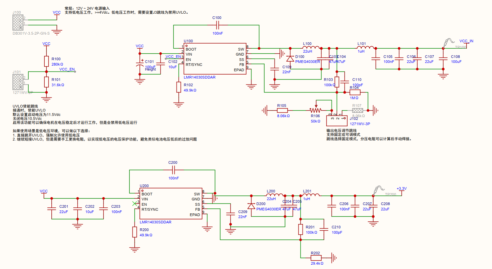

#### 欠压保护电路 (J101)
* 通过 `R100`（280kΩ）和 `R101`（31.6kΩ）分压接入 `U100` 的 `EN` 引脚。
* **默认短接**：跳线短接时使能，设定**启动电压为 11.5V**，**关闭电压为 10.5V**。
  * *作用*：确保输入电压足够稳定时电机才开始工作，防止电池供电时发生过放电。
* **开路（低压模式）**：若在低于 11.5V 供电环境使用，可断开 `J101` 跳线以禁用 UVLO，芯片最低可支持 **4V 正常工作**，适用于单/双节电池供电模式。

#### 电机供电可调输出 (J102)
* 配备了电压调节跳线与可调电阻 `R106`（50kΩ）。
* **调节功能**：支持固定或可调输出模式。通过精密调节可调电阻，能将 `VCC_IN` 稳定在 TMC2300 电机驱动所需的最佳工作电压（TMC2300 常用电压范围一般在 1.8V~11V）。

#### 二级滤波（LC 纹波抑制）
1. 由主电感 `L100`（22µH）与 `C103/C104`（47µF）组成一级 Buck 滤波。
2. 随后通过磁珠/小电感 `L101`（1µH）及 `C105~C108` 组成 **LC ∏型滤波器**，用于深度滤除开关高频噪声，为电机和敏感驱动部分提供纯净的电源。  

#### 进一步潜在优化项
受限于空间和成本，当前设计保留了一些潜在优化可能，在后续版本中可能会考虑实现。  
1. 在 VCC_IN 电源输入接口处预留大容量电解电容（如100μF~470μF）的焊盘位置。步进电机在斩波驱动和频繁加减速时会产生巨大的瞬态电流需求，大容量储能电容可有效平抑母线电压跌落，维持功率级供电稳定。
2. 在电源输入端增加防反接保护电路。采用P-MOSFET构成的防反接电路或串联肖特基二极管，避免测试台供电极性接反导致后级驱动芯片及MCU不可逆烧毁。
3. 为保证功率测量的基准纯净，在电源输入端配置完善的滤波网络：大容量电解电容负责低频储能，高频陶瓷去耦电容（100nF/10μF）吸收PWM斩波产生的高频纹波，并串联共模电感抑制共模干扰，防止电机驱动噪声耦合至测量与控制回路。
4. 规避电机上电瞬间电流突升会导致电磁力突变，引发机械冲击与振动。建议在电源控制端引入RC缓启动电路，将电流上升沿拉长至数十毫秒，可将上电冲击电流降低60%以上。在TMC2300 的使能引脚（EN ），增加一个RC延时，在电阻两端并个反向二极管，用于断电时快速放电。
5. 针对电机受外力突发反转或急停产生的反电动势（可能击穿驱动管），构建立体防护：   
续流与吸收：在驱动输出端（至电机绕组）配置快恢复续流二极管提供泄放回路；并在绕组两端并联RC阻容吸收网络（如100Ω+10nF），削减高频电压尖峰。  
过压钳位：在驱动电源输入端及输出端并联TVS瞬态抑制二极管或压敏电阻（MOV）。当反向电动势导致母线电压飙升时，TVS/MOV能ns级响应，将电压钳位在安全工作区，保护后级芯片。  
6. 在TMC2300驱动芯片及采样电阻近端部署NTC温度传感器，实时监控热失控风险，并设定阈值实现超温硬件级关断或软件降额，保障系统长期运行的可靠性与测量参数的一致性。

### 2. TMC2300 驱动电路设计  
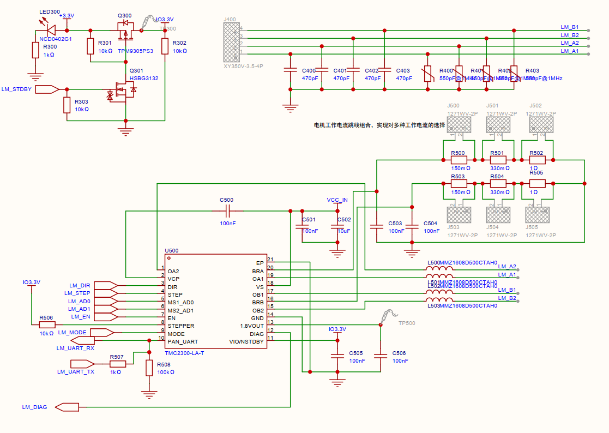
#### 核心控制接口与配置
芯片的控制引脚直接与主控（ESP32-S3）相连，支持单线 UART 配置或传统的脉冲/方向控制：
* **控制信号**：`LM_DIR`（方向）、`LM_STEP`（脉冲步进）和 `LM_EN`（使能脚）构成基本的电机控制接口。
* **通信接口**：芯片第 10 引脚（`PAN_UART`）通过 `R507`（1kΩ）连接到 `LM_UART_TX`，并通过 `R508`（100kΩ）下拉，支持主控通过 **单线 UART** 配置芯片的内部寄存器（如电流、细分、StealthChop 模式参数等）。
* **地址与模式配置**：`MS1_AD0` 和 `MS2_AD1` 用于设定 UART 通信的硬件地址。`R506`（10kΩ）将 `LM_MODE` 上拉至 `IO3.3V`，使芯片工作在预定模式。
* **诊断输出**：`LM_DIAG`（第 12 引脚 DIAG）输出异常诊断信号，可用于过温、过流等故障检测送回主控。

#### 待机与电源控制
电路设计了一个由 PMOS（`Q300`）和 NMOS（`Q301`）组成的电源开关切换电路：
* **逻辑机制**：当主控拉高待机控制信号 `LM_STDBY` 时，`Q301` 导通，进而将 `Q300` 的栅极拉低使其导通，从而将 `IO3.3V` 电源送至右侧的 `!O3.3V` 节点。
* **芯片供电**：`IO3.3V` 负责为 TMC2300 的第 11 引脚 `VIO/NSTDBY` 供电。
* **节能设计**：当系统处于休眠或长期待机状态时，主控可以关闭 `LM_STDBY`，彻底切断 `VIO` 电源并将芯片置于极低功耗的待机模式，同时 `LED300` 指示灯熄灭。

#### 电机工作电流跳线选择电路
该设计并没有采用固定的采样电阻，而是通过 **跳线组合（J500 ~ J505）** 来灵活改变反馈电流（`BRA` 和 `BRB` 引脚的采样电阻阻值）：
* **电阻网络配置**：
  * **第一组（J500/J503）**：`R500`（150mΩ）/ `R503`（150mΩ）
  * **第二组（J501/J504）**：`R501`（330mΩ）/ `R504`（330mΩ）
  * **第三组（J502/J505）**：`R502`（1Ω）/ `R505`（1Ω）
* **设计作用**：通过手动插拔跳线帽或焊接选择不同的跳线组合，可以改变 `BRA` 和 `BRB` 相对地（GND）的等效并联电阻阻值。根据公式：
  \[\text{I}_{\text{rms}} \propto \frac{1}{\text{R}_{\text{sense}}}\]
  这实现了**无需重新焊接，即可快速手动调节和选择多种不同大小的电机工作电流**的目的，大大提高了硬件板卡的通用性。

#### 输出滤波与 EMC 优化
在芯片的输出端（`OA1`, `OA2`, `OB1`, `OB2`）到电机接口（`J400`）之间，设计了精细的滤波和电磁兼容（EMC）防护：
* **磁珠隔离**：输出端串联了高频磁珠 `L500 ~ L503`（型号如 MMZ1608、MMZ1808 等），专门用于抑制高频 H 桥开关噪声，防止其向外辐射。
* **滤波电容网络**：在电机输出线路上并联了 `C400 ~ C403`（470pF）以及 `R400 ~ R403`（阻值通常很小，并在 1MHz 下呈现特定阻抗）组合。它们构成低通滤波器，吸收步进电机线圈产生的反向电动势高压脉冲和毛刺，保护芯片内部的 MOSFET 不被击穿，同时降低电磁辐射。

---

## 电路板 Layout 优化注意事项

### 1. TMC2300 散热设计
TMC2300 的封装非常紧凑，驱动电机的电流以及实际工作功率可能比较大，造成的局部升温会非常明显。因此，热设计（Thermal）和电源/地回路（Power Integrity）的 PCB Layout 设计至关重要。

TMC2300 的底部中心有一个裸露的接地散热焊盘（Exposed Die Pad, EP），这是芯片主要的散热通道。设计时应注意：
* **多层板与完整地平面**：有条件的情况下，建议使用 **4 层板** 设计。将第二层（Layer 2）作为完整的 GND 平面，提供巨大的热容。
* **热过孔（Thermal Vias）设计**：在芯片底部的 EP 焊盘上，必须放置 **4 到 6 个散热过孔**（孔径 0.3mm 左右）。过孔不要加绿油盖孔，直接通向底层（Bottom）和内层的 GND，把热量传导到大面积铜皮上。
* **背面开窗**：在 PCB 的底层（Bottom Layer）对应芯片焊盘的位置进行大面积敷铜并去阻焊层（开窗镀锡），增加空气对流散热，必要时可加贴小型散热片。

> ⚠️ **热工测试规范**：在实际测试时，应在设计最大功率及最大电机工作时长的情况下，对系统进行持续运行测试。使用**红外热成像相机**抓取从电源到 TMC2300 的运行温度图，详细分析各个单元的实际温升，以便做进一步的设计调整和改进。

### 2. 电源布局和滤波
采用开关电源芯片进行大电流切动时（H 桥开关），会在电源线上产生剧烈的电压脉冲和纹波。因此，设计上应该注意以下相关原则：
* **就近原则**：大电容和去耦电容必须靠近芯片的 `VS` 与 `GND` 引脚。
* **先大后小**：电源线进入芯片前，应当先经过大容量电容，再经过小容量电容，最后进入芯片引脚。
* **电容地回路**：这些电容的地端（GND），要通过多个大孔径过孔直连到大面积地平面，确保 H 桥的高频电流能快速就近回流。

### 3. 地平面隔离与单点接地
* **功率地与信号地分割**：将板上的地分为电机功率地（`PGND`）和系统信号地（`AGND`/`GND`）。
  * **PGND 区域**：包含 TMC2300 芯片底部 EP、电源输入电容地端、采样电阻地端。此区域应有独立的大面积敷铜。
  * **AGND 区域**：包含 ESP32-S3、通信接口、TMC2300 的 `VIO` 电容地端。
* **单点连接**：两个地平面在整块板上只在**一点**（通常是电源总输入的负极处，或者通过一个 0 欧姆电阻/磁珠）进行硬连接，避免大电流回流涌入主控的地网，导致 ESP32 重启或 UART 通信丢包。

### 4. 电机供电电源线路设计与 EMC 优化
从芯片输出到电机接口的 4 条线路承载着驱动电机的全部大电流。其设计原则为：
* **线宽与铜厚**：在 1oz 铜厚下，建议走线宽度不低于 **0.8mm ~ 1.2mm**（如果有空间，越粗越好）。若条件允许，采用 **2oz 铜厚** 可以显着降低发热。
* **磁珠与电容摆放**：滤波磁珠和滤波电容应当紧靠芯片输出脚摆放，先吸收高频毛刺，然后再一路加粗走线引向电机插座。
* **远离敏感信号**：这 4 条输出线充斥着高频高压的 PWM 信号，**严禁**与主控的 `UART`、`STEP/DIR` 等弱电信号线平行长距离走线，防止产生电磁串扰（Crosstalk）。

---

## 固件（Firmware）程序设计

固件开发基于 **ESP-IDF** 的 FreeRTOS 系统，采用 **C 语言** 进行核心代码开发。  

### 1. 代码架构设计
代码架构采用自建的基于任务系统的**朴素有限状态机 (FSM)**。

#### 主状态架构
[主状态架构](./Images/fsm_main.png)  

#### 子状态（电机运行状态架构）
[子状态示例](./Images/fsm_run.png)  

#### 主要程序核心运行逻辑
1. 主程序在完成固件和相关硬件的初始化后，进行状态机的初始化，并进入状态机初始化完成状态。
2. 状态机完全接管系统运行，并根据不同的操作指示，切换不同的状态以确保操作指令得到完整运行。
3. 异常情况则通过切换至**异常状态（MODE_ERROR）**进行异常处理和即时反馈。

> 📝 *注：实际代码实现请参见项目工程中的状态机核心源码段落。*

### 2. TMC2300 串口通信代码架构
在实际应用中，系统潜在存在大量的电机运行控制命令和状态查询命令的交互。因此，串口收发数据通过使用队列（Queue）、互斥锁（Mutex）等 RTOS 同步机制，以确保相关控制/查询命令的完整收发、次序执行，并有效避免资源冲突与阻塞占用。

#### 串口任务分配
采用独立的双任务处理机制：
* 独立的串口发送任务：`static TaskHandle_t motor_uart_send_task_handle = NULL;`
* 独立的串口接收任务：`static TaskHandle_t motor_uart_rec_task_handle = NULL;`

#### 队列和互斥锁配置

| 名称 | 类型 | 用途 |
| :--- | :--- | :--- |
| `s_motor_uart_rec_queue` | `QueueHandle_t` | UART 接收事件队列 |
| `uart_cmd_queue` | `QueueHandle_t` | 命令发送队列 |
| `uart_tx_mutex` | `SemaphoreHandle_t` | UART 发送互斥锁 |

#### 相关核心数据结构体

```c
typedef struct
{
    uint8_t cmd[CMD_MAX_LEN];
    int cmd_len;
    // uart_send_fail_callback_t fail_callback;  // 发送失败回调函数指针，暂时不用
    int resp_len;
    uint8_t reg_addr;
    motor_uart_communicate_type_t type;
    bool is_pending;
} uart_cmd_t;

typedef struct 
{
    // 命令信息
    uint8_t cmd_buf[CMD_MAX_LEN];
    int cmd_len;
    
    // 响应信息
    uint8_t *resp_buf;               // 存放响应的缓冲区
    int resp_max_len;
    int resp_len;                    // 实际接收到的响应长度
    
    // 针对TMC2300通信的特定字段
    motor_uart_communicate_type_t type;
    uint8_t reg_addr;
    uint32_t reg_data_read;
    bool is_correct;
    
    // 同步机制：从信号量修改为任务通知（Task Notification），减少系统开销
    TaskHandle_t task_handle;        // 发送任务的句柄
    uint32_t id;                     // 请求ID，由随机数生成，用于匹配响应和请求
    TickType_t timeout_ticks;
    
    // 标志位：标记此请求是否仍在等待响应
    volatile uint8_t is_pending;
} uart_cmd_request_t;

static uint8_t uc_motor_reg = 0;

/**
 * @brief 电机状态检查日志结构体
 * @details 用于记录电机状态检查的结果，包括当前时间、当前循环次数、电机状态、MSCNT值、SG值等。
 */
typedef struct 
{
    uint32_t time_tick;
    uint32_t cur_cycle_count;
    char motor_status;
    
    // MSCNT计数依赖串口，此方案已切换为使用更精准的脉冲计数
    uint16_t mscnt;
    bool mscnt_valid;
    uint32_t pluse_count;
    bool pluse_count_valid;
    
    // 扭矩余量
    uint16_t sgvalue;
    bool sgvalue_valid;
} motor_check_log_t;

static volatile motor_check_log_t motor_check_log;

/**
 * @brief 电机MSCNT检查结构体
 * @details 用于记录电机MSCNT值的检查结果，包括目标值、当前值、前一个值、是否启用慢进、是否运行慢进、慢进速度、是否停止等。
 */
typedef struct 
{
    bool valid;
    bool direction;
    uint32_t mscnt_target;
    uint32_t mscnt_current;
    uint32_t mscnt_previous;
    bool slowapproach_enable;
    bool slowapproach_run;
    int32_t slowapproach_speed;
    bool stop;
} motor_mscnt_check_t;

static volatile motor_mscnt_check_t motor_mscnt_check = { false, true, 0, 0, 0, false, false, 0, false };

typedef struct 
{
    uint32_t target_pulse;    
    bool close_target;
} motor_pluse_check_t;

static volatile motor_pluse_check_t motor_pluse_check = { 0, false };

// 非阻塞底层字节发送函数接口
esp_err_t app_exuart_bytes_noneblock(
    char *tx_message,
    size_t tx_message_size,
    TickType_t tx_none_block_timeout);
```

#### 串口收发功能流程
##### 1. 初始化流程

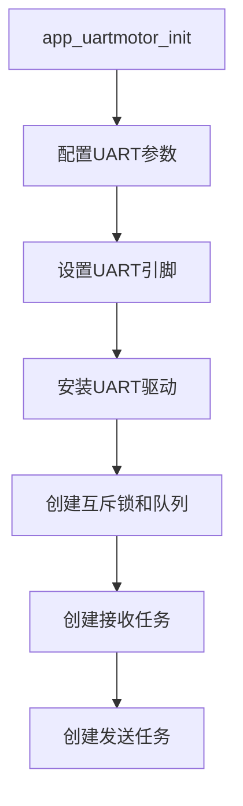

##### 2. 发送命令流程

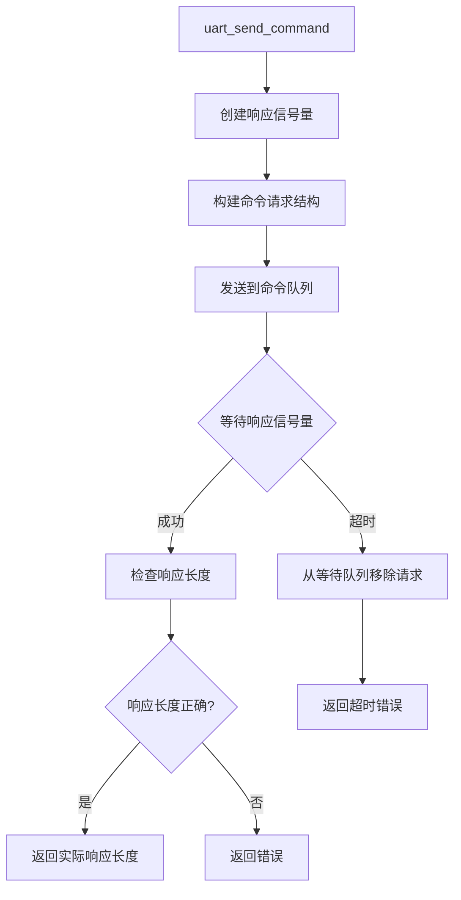

##### 3. 发送任务流程

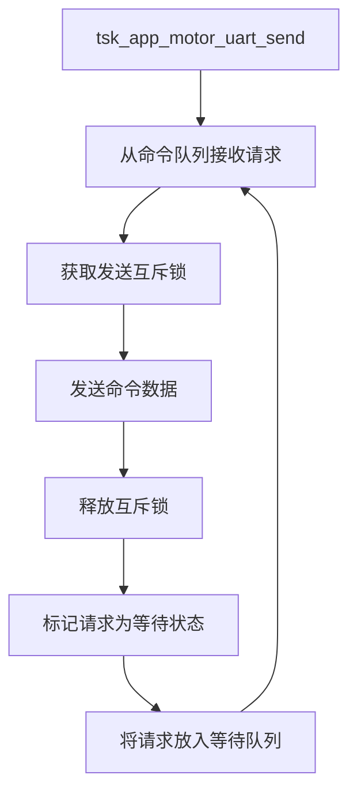

##### 4. 接收任务流程

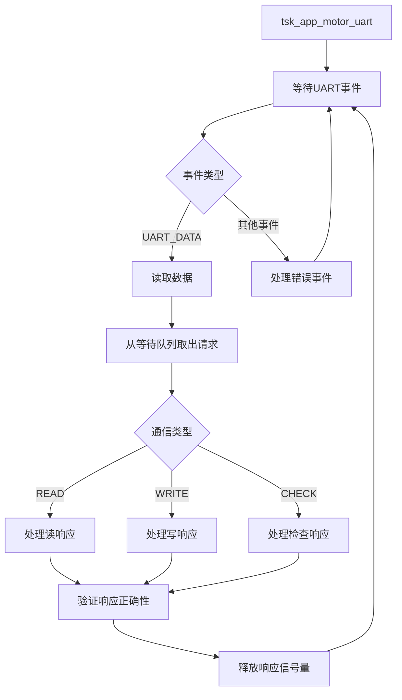

##### 5. TMC2300通信流程

###### 5.1 写操作

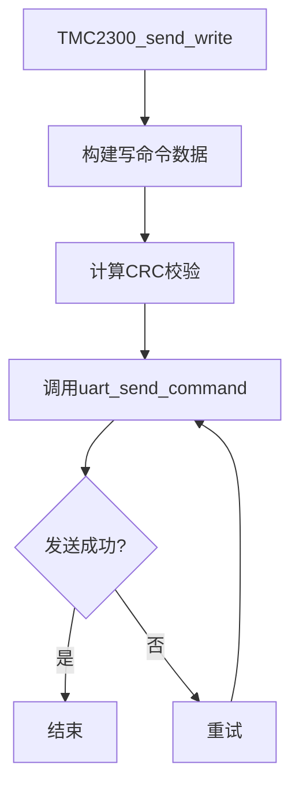

###### 5.2 读操作


##### 6. 数据处理流程

###### 6.1 读响应处理

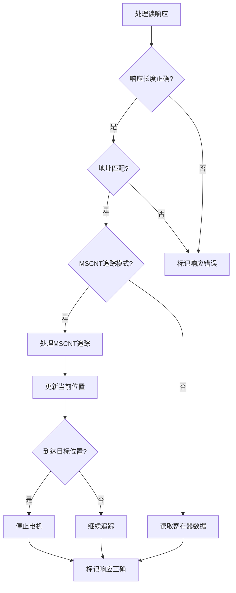

###### 6.2 写响应处理

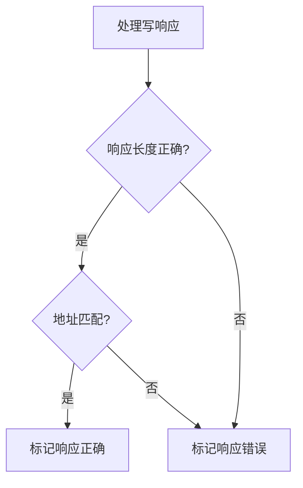

###### 6.3 检查响应处理

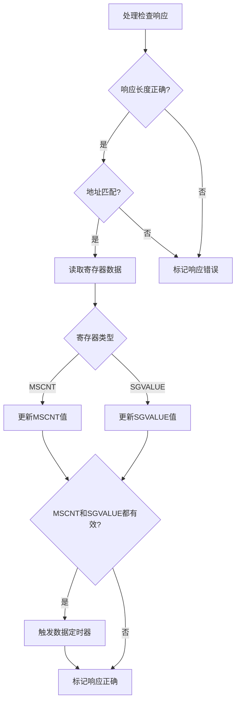

## 上位机软件（Software）设计
上位机软件采用VS的C#语言开发，采用WPF MVVM架构，快速实现对TMC2300的参数获取，运行控制和实时数据采样。
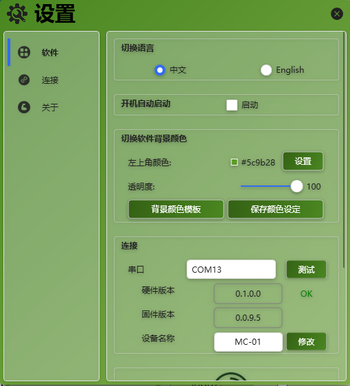  
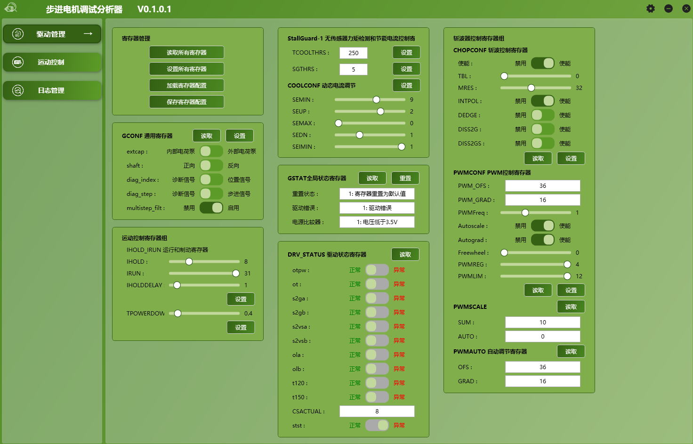  
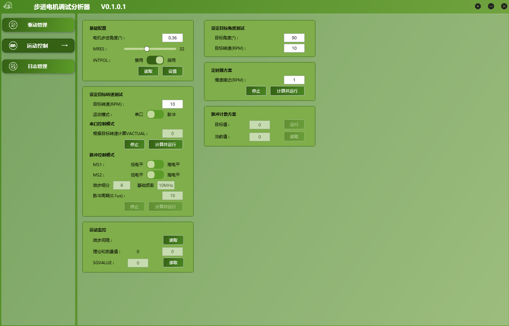  
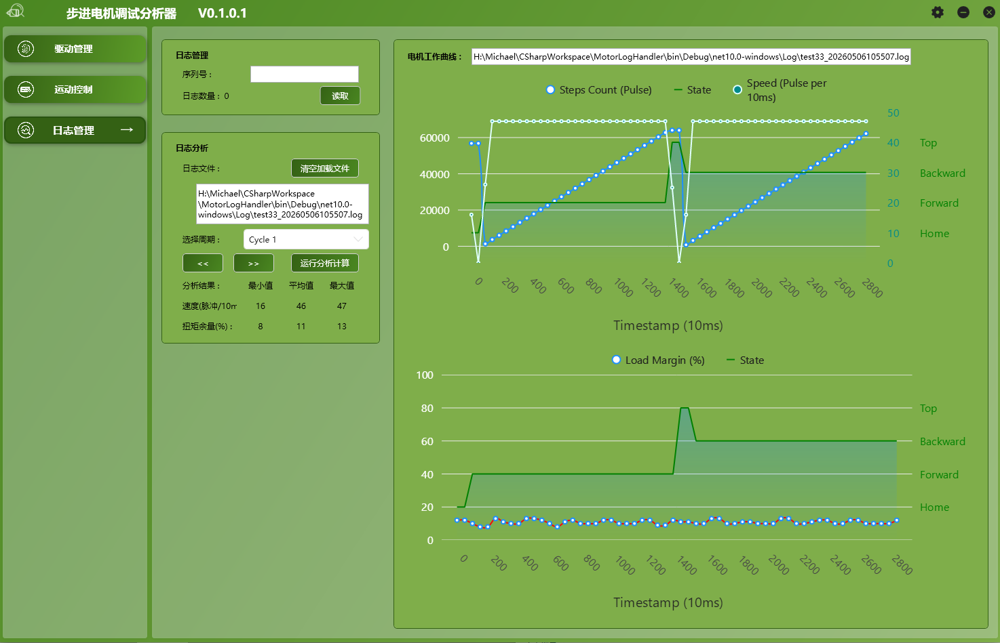  
  
## Android软件（APP）设计
利用ESP32特有的蓝牙（WIFI）特性，开发一个Android应用，实现对TMC2300的参数获取，运行控制和实时数据采样。
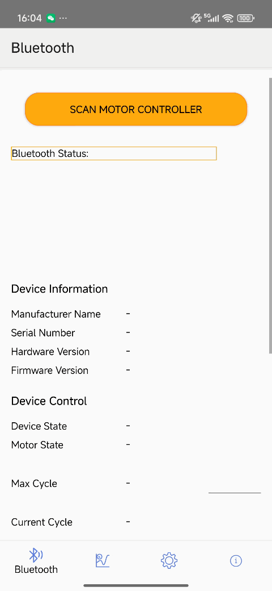  

## 系统运行示例
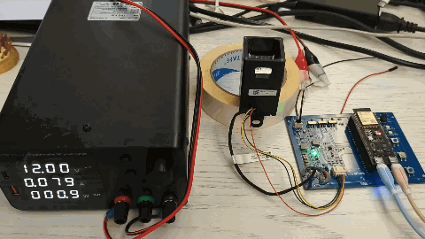 
